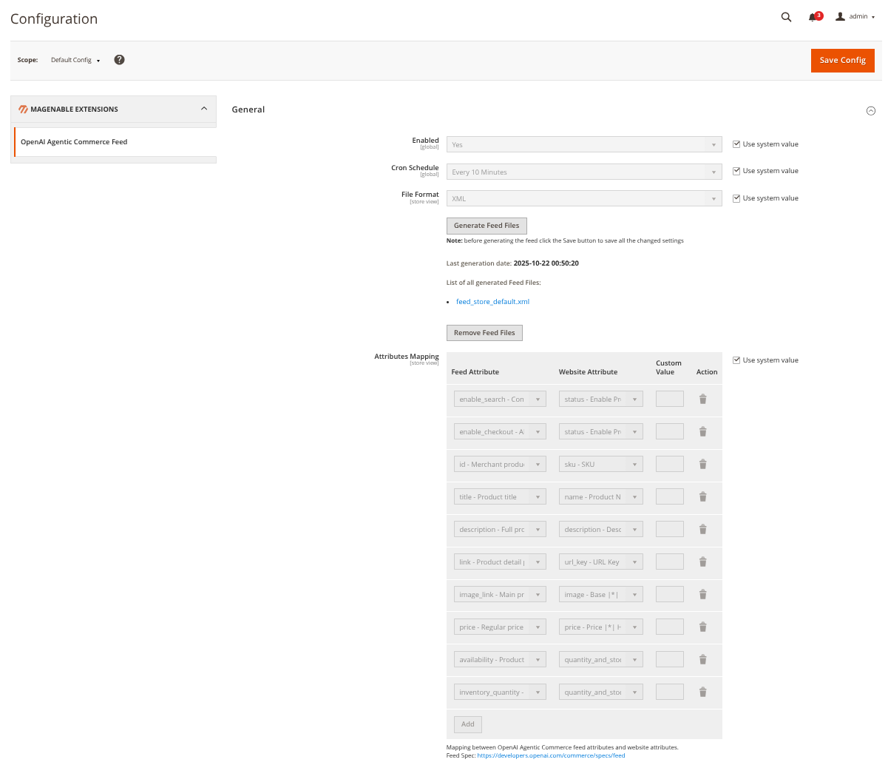

# Magenable - OpenAI Agentic Commerce Feed

**Magenable - OpenAI Agentic Commerce Feed** is a Magento 2/Adobe Commerce module that provides the ability to generate feed files for OpenAI Agentic Commerce.

## Installation

### Composer:

Run the following command in Magento 2 root folder

```
composer require magenable/module-openai-agentic-commerce-feed
bin/magento setup:upgrade
bin/magento setup:di:compile
```
## Upgrade

### Composer:

Run the following command in Magento 2 root folder

```
composer update magenable/module-openai-agentic-commerce-feed
bin/magento setup:upgrade
bin/magento setup:di:compile
```

## User Guide

### Configuration:

Go to **Stores** > **Settings** > **Configuration** > **Magenable Extensions** > **OpenAI Agentic Commerce Feed**.

#### General

- `Enabled` - Enable or Disable the module for generating feeds by Cron Schedule
- `Cron Schedule` - Cron Schedule to run feed generation
- `File Format` - Options to select a format for feed files
- `Generate Feed Files` - Button to run the feed files generation process
- `Remove Feed Files` - Button to remove all generated feed files
- `Attributes Mapping` - This field allows to map OpenAI Agentic Commerce Feed Attributes and Magento Website Attributes for the feed generation (Note: website Attributes marked with the following string `|*| Has attribute processor for: some_feed_attribute, some_feed_attribute |*|` has special logic in the module to prepare their values for appropriate format of Feed Attributes)



#### Compatibility
Tested with Magento Open Source 2.4.4 - 2.4.8, but will probably work with older Magento 2.X versions and Adobe Commerce

#### About developer
The extension is developed by Magenable (https://magenable.com.au), eCommerce consultancy specializing in Magento/Adobe Commerce based in Melbourne, Australia
